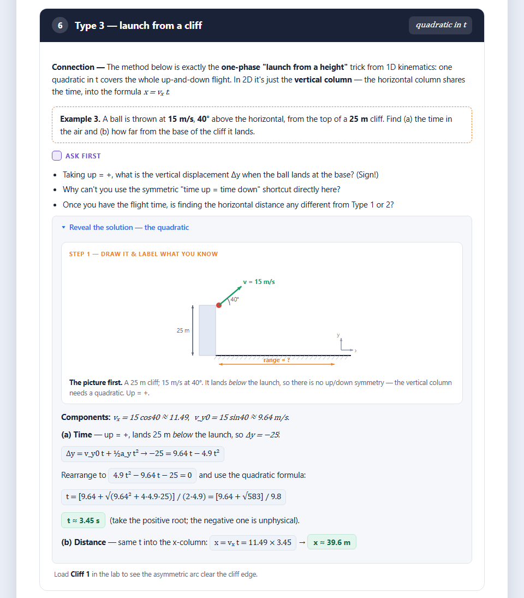

# tutoring-skills

Seven Agent Skills for Claude Code (and Codex) that build and check tutoring materials: a course
syllabus, interactive HTML lessons, homework with staged hints, diagrams and animations, and a
verification pass before anything reaches a student.

I built these for my own physics tutoring (Ontario Grade 12 and CÉGEP mechanics) and use them to
make the lessons and homework I teach from.

## Who it's for

Tutors and teachers who use Claude Code or Codex and want generated lessons and homework to be
checked before a student sees them. The worked examples and research notes lean toward
high-school and first-year physics and math; the workflow itself is not physics-specific.

## The pipeline

```
create-syllabus → create-lesson → create-homework → add-diagrams / add-visuals → verify-material or verify-light
```

| Skill | What it does |
|---|---|
| `create-syllabus` | Reconstructs a unit-by-unit curriculum spec for a course from its governing curriculum document, with sources, stated assumptions, and a gap analysis. |
| `create-lesson` | Builds a single-topic interactive HTML lesson: hook with an animated visual, concept checks, worked examples (ask → solve → watch), misconceptions, closure, and practice with staged hints. |
| `create-homework` | Builds a take-home assignment: retrieval warm-up, one or two new application concepts, unguided "sister" problems, spaced review, hardest items calibrated to the real assessment. Optional print/PDF version. |
| `add-diagrams` | Adds the static, labelled setup diagram a solver would sketch (situation, free-body, component triangle, graph) as step 1 of a worked solution. |
| `add-visuals` | Adds animated or interactive visuals (synced graphs, phase-by-phase players, parameter explorers) to an existing lesson or homework. |
| `verify-material` | Full pre-send check: deterministic checks, then two independent model reviewers (Opus and Sonnet), capped revisions, human sign-off. |
| `verify-light` | Shorter pre-send check: deterministic checks, one Sonnet reviewer, one revision round, human sign-off. |

## What's different

- **Code checks come before model review.** Every number and every displayed intermediate step
  is recomputed in Python with domain cross-checks (conservation, back-substitution, sign and
  unit checks). The JS is syntax-checked with `node --check`, tags are balanced, and the page is
  rendered to images with every collapsed solution forced open. Reviewers run only after that.
- **Two independent reviewers, then a person.** `verify-material` launches an Opus reviewer and
  a Sonnet reviewer in parallel with the same rubric and the code-verified results. Both are
  report-only and cannot see each other. Findings both flag get priority, revisions are capped at
  two rounds, and a human approves before anything goes to a student. The reasoning and sources
  (LLM self-correction, LLM-as-judge bias, critic-assisted review) are in
  `skills/verify-material/references/reviewer-prompts.md`.
- **Diagram geometry is computed.** Arrow angles, triangle vertices, and arc endpoints come from
  code, not hand-placed coordinates. Label positions are chosen from the geometry (the side away
  from the shape's centroid; narrow angles get a symbol and a legend), and an `auditLabels` check
  flags clipped or overlapping labels before the figure is rendered.
- **Known animation bugs are designed out.** `add-visuals` keeps an internal clock instead of
  reading a range input (which snaps to its step), uses one time rate across phases, guards the
  animation loop, and ships a jsdom test harness that simulates step snapping.
- **Output is a single file.** Each lesson or homework is one self-contained HTML file (inline
  CSS and JS, no dependencies) written to the student, with no tutor notes in the text.

## Install

### Claude Code (plugin)

```
/plugin marketplace add ariaz123git/tutoring-skills
/plugin install tutoring-skills@tutoring-skills
```

From a shell: `claude plugin marketplace add ariaz123git/tutoring-skills`, then
`claude plugin install tutoring-skills@tutoring-skills`.

The skills are then available as `/tutoring-skills:create-lesson`, `/tutoring-skills:verify-light`,
and so on. Claude also picks a skill on its own when a request matches its description.

### Claude Code (manual)

```
git clone https://github.com/ariaz123git/tutoring-skills.git
mkdir -p ~/.claude/skills
cp -r tutoring-skills/skills/* ~/.claude/skills/
```

Copy all seven folders together. Several skills point to each other's reference files with
relative paths (for example `../verify-material/references/rendering-and-proofing.md`).

### Codex

Each skill is a standard `SKILL.md` folder, so the same folders work in Codex. Copy the contents
of `skills/` into `~/.agents/skills/` (all projects) or `.agents/skills/` in a repository.
`verify-light` includes `agents/openai.yaml` with its display name and default prompt for the
Codex interface.

The two verify skills name Claude models for their reviewers. `verify-light` is written to stop
and tell you if a Sonnet reviewer is not available, rather than substitute another model.

### Tools the skills expect

Python 3 for number checks, Node.js for `node --check` and jsdom tests, and Chrome or Edge for
headless rendering. WeasyPrint is optional, for PDF output.

## Example output

[`examples/projectile-motion-lesson.html`](examples/projectile-motion-lesson.html) is a
projectile-motion lesson built with `create-lesson` and taught in my own tutoring. Download it
and open it in a browser; it has no dependencies. It contains three worked examples, a
drop-vs-shoot animation, and a projectile lab with sliders and presets for the table and cliff
examples.



## License

The skills, plugin manifests, and README are MIT licensed (see [LICENSE](LICENSE)). The example
lesson in `examples/` is licensed under [CC BY 4.0](https://creativecommons.org/licenses/by/4.0/).
